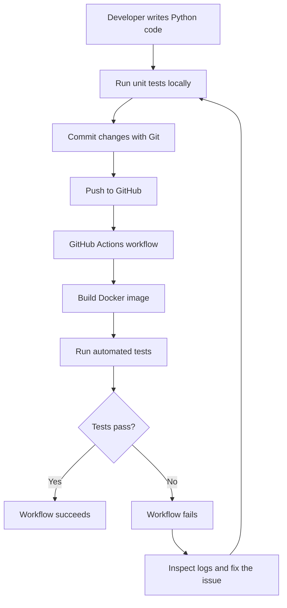

# Python Calculator DevOps Project: Architecture

## 1. Overview

This project implements a Python calculator that supports addition, subtraction, and multiplication of two positive integers. It demonstrates containerization with Docker and Continuous Integration (CI) using GitHub Actions.

## 2. Architecture Diagram

## 3. Component Description

- **Python application:** Performs addition, subtraction, and multiplication.
- **Unit tests:** Verify that calculator functions return the expected results.
- **Git:** Tracks changes and records commits.
- **GitHub repository:** Stores the source code and workflow configuration.
- **Docker:** Packages the application and its runtime environment into an image, from which containers can be created.
- **GitHub Actions:** Automatically executes the configured CI workflow when code is pushed.

## 4. Working Flow

1. The developer modifies the calculator application or its tests.
2. Unit tests can be executed locally to identify errors early.
3. Changes are committed using Git and pushed to GitHub.
4. GitHub Actions automatically triggers the configured workflow.
5. The workflow builds the Docker image and executes the configured tests.
6. If all required steps succeed, the workflow finishes successfully.
7. If a test fails, the workflow reports failure. The developer examines the logs, fixes the issue, and pushes the correction.

## 5. Failure Handling

A deliberately incorrect expected value in a unit test was used to validate the CI failure mechanism. The workflow failed when the test failed. After correcting the expected value and pushing the fix, the workflow succeeded again.

## 6. Scope

This project demonstrates local development, Docker-based containerization, automated testing, version control, and continuous integration. AWS deployment is outside the scope of the current implementation.
